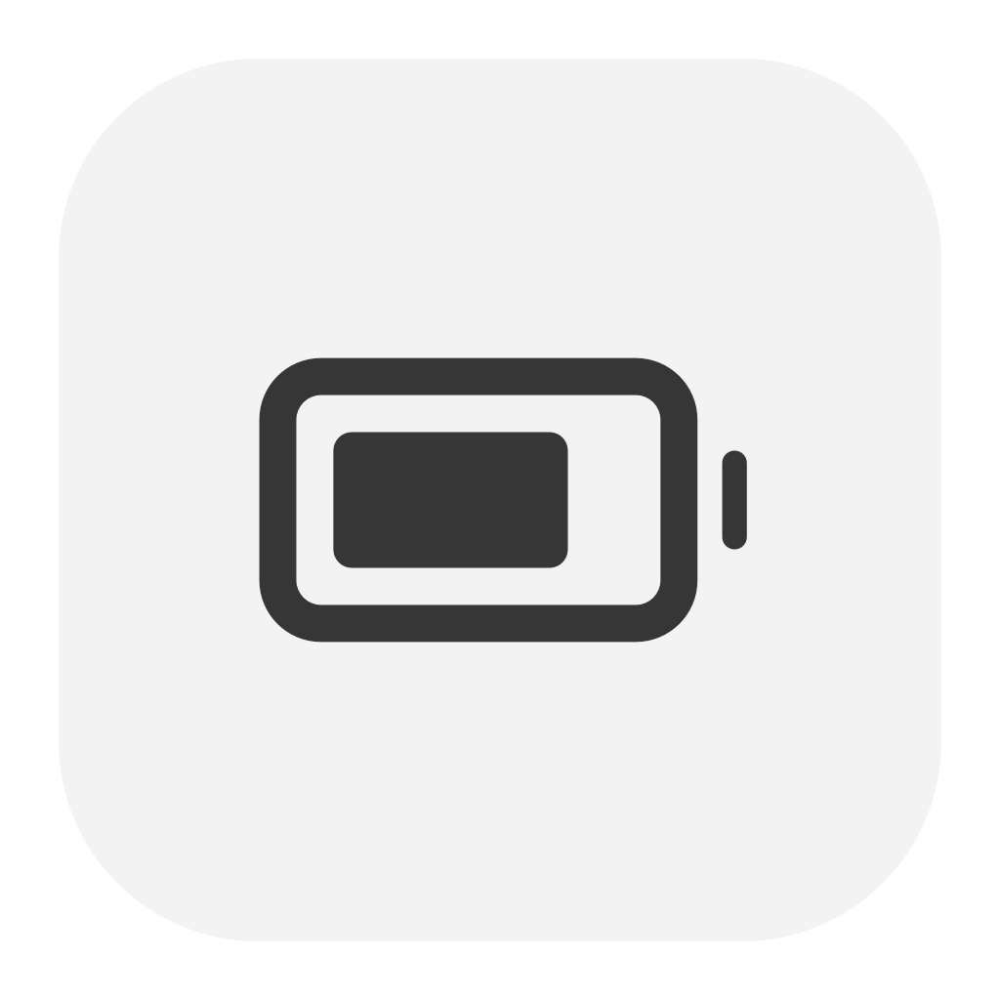

<p align="center">
  
</p>
<h1 align="center">Cell</h1>
<p align="center">Power flow and charge control for your Mac.</p>
<p align="center">
  
  
  
</p>

Cell shows live power use and controls charging from the menu bar. Set a battery charge limit and choose separate energy modes for battery and charger use. It shares a monochrome style with [Snap](https://github.com/upsidedly/snap) and [Tuck](https://github.com/upsidedly/tuck).

## Power flow

Click the menu bar icon to see three readings:

| Reading | Shows |
| --- | --- |
| Adapter | Power entering your Mac from its charger |
| Mac | Power used by your Mac |
| Battery | Power used to charge the battery, or supplied by it |

The arrows show the battery’s direction. Readings update while the popup is open. Unknown readings show a dash. Charger capacity is not used as a live watt reading.

The menu bar shows the current macOS battery icon with your battery percentage beside it. Watts stay in the popup.

## Charge limit

Choose a limit from **80% to 100%**, using the values your Mac supports. Cell reads the setting back before it shows the new value. Starting the app does not change your limit. macOS keeps it when you quit.

Apple’s native limit stops charging within a few percentage points and can occasionally charge to 100% for calibration. It does not force the battery to discharge when you lower the limit.

## Energy modes

Choose **On battery** and **On charger** independently in the popup. Cell shows the Low Power, Automatic and High Power choices supported by each source. A change opens macOS’s authorization prompt and is shown only after macOS confirms it. Your choices persist when Cell quits; opening the app does not change them.

## Settings

Click the gear or right-click the menu bar icon to open **Settings…**. Hide the percentage, place it to the left or right of the battery, or open Cell at login. **Open at login** starts off.

## Download

Download the latest [release](https://github.com/upsidedly/cell/releases/latest), open the `.dmg`, and drag **Cell** into **Applications**. These builds are for Apple silicon Macs. Quit an older Cell before replacing it.

The app is locally signed and is not notarized. macOS may require first-launch approval in **System Settings → Privacy & Security**.

## Install from source

Use an Apple silicon Mac with macOS 26.4 or later and Swift 6.

```sh
git clone https://github.com/upsidedly/cell.git
cd cell
./scripts/install.sh
open /Applications/Cell.app
```

The script builds and signs the app locally and backs up an earlier installation. Quit Cell before updating it. Reading power use and changing the charge limit need no administrator, Accessibility or Screen Recording permission. Energy-mode changes require macOS authorization; Cell installs no privileged helper.

## Compatibility and privacy

Cell uses Apple’s private PowerUI interface for native charge limits. A macOS update can change it. If it becomes unavailable, Cell offers a link to Battery settings.

Power readings stay in memory. Cell does not use the network, save a sensor history or require an account.

## Development

Build with `./scripts/build.sh`. Run the core checks with `./scripts/check.sh`. Set `CELL_SDK` to use another compatible macOS SDK without changing your global Xcode settings.

